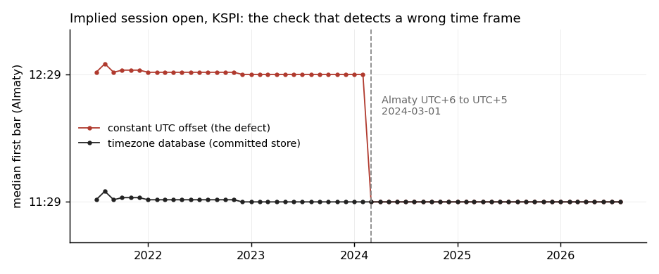
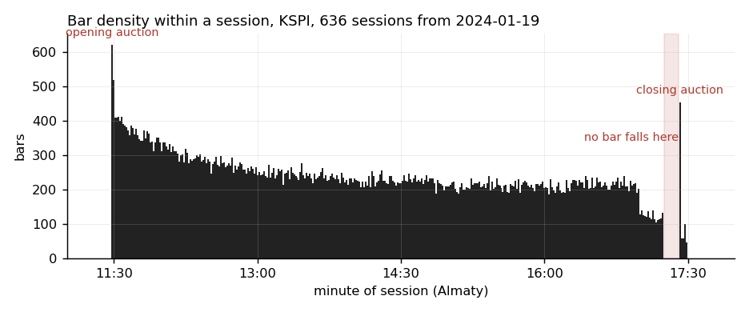
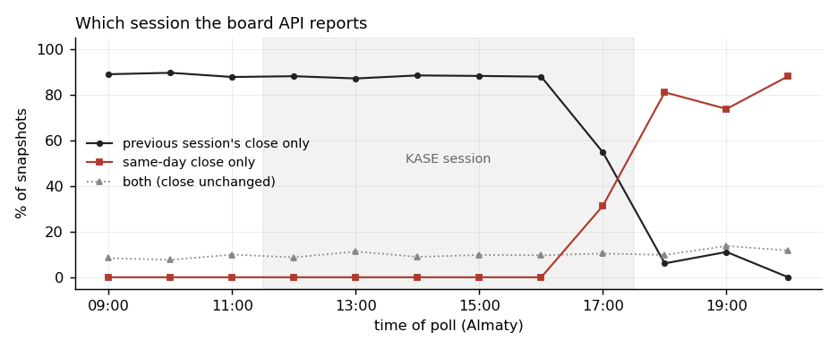
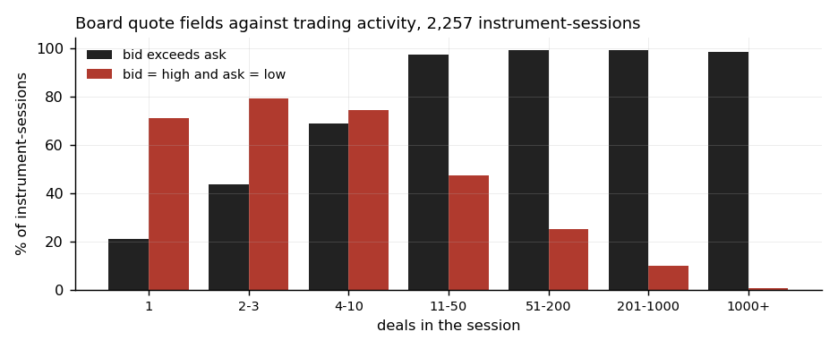

# KASE market data: acquisition, validation, and board-feed provenance

This repository holds the acquisition code behind a study of dual-listed Kazakh equities: a
1-minute bar fetcher for the Kazakhstan Stock Exchange (KASE) and for Kaspi.kz's NASDAQ line, a
daily companion fetcher, recorders for KASE's trade-results board, and the analysis that
identifies what that board's quote-labelled fields contain. The companion `kase-price-discovery`
repository reads the store these fetchers build. The write-up is `docs/dataset-and-provenance.md`;
this README is the summary and the instructions for reproducing it.

## Findings

- The store holds 2,476,602 one-minute bars for 24 KASE instruments from 2015-05-25 to
  2026-08-24 in 2,472 monthly partitions, and 119,650 bars of KSPI on NASDAQ (the partitions hold
  26 duplicate rows at month boundaries) from 2024-01-19 to 2026-03-31. Coverage is uneven: HSBK
  reaches 2015, KSPI's minute history effectively begins in July 2021 despite a 2018 listing, and
  398 partitions are empty.
- Seven defects in the endpoint's responses corrupt a naive fetch, six of them without raising an
  error. The worst is the timestamp frame: values are venue-local wall clock in a fixed UTC+3
  frame, and a constant offset stores every bar before Almaty's 2024-03-01 move from UTC+6 to UTC+5
  one hour late, invisible to any price-based check. The committed store's implied open is 11:29 on
  both sides of the change.
- The served history has artefacts of its own, found by a later re-analysis and measured here:
  flat bars at fixed times outside the session in 2016 to 2019 that repeat the previous close on
  95% to 100% of occurrences in HSBK, KZTO and KEGC; a collection hole of 148 trading dates from
  2015-06-24 to 2016-01-28; 63 empty months contradicted by the same endpoint's daily series; and a
  change on 2026-03-10 after which the daily series' close matches the minute store's last bar on
  17.5% of instrument-sessions instead of 97.2%.
- KASE's trade-results board publishes the completed previous session and is frozen during the
  trading day: no change in bid, ask, last, high, low or deal count across 2,061 instrument-days
  with repeated in-session snapshots, 97.8% of 5,039 in-session rows equal to the previous
  session's close to the cent, and a switch to the same day between 17:30 and 17:35 Almaty. Every
  test on the board joins one session back.
- The board's `current_bid` and `current_offer` are not a two-sided quote. The bid exceeds the ask
  on 90.6% of 2,257 instrument-sessions, and the pair sits on the session's high and low, to the
  cent, in 71.2% of one-deal sessions and 0.5% of sessions with more than 1,000 deals. The
  best-supported reading is the session's extreme quotes; against the store's session range the bid
  is at or above the high on 93.6% of sessions and the ask at or below the low on 95.4%, with a
  6.4% and 4.6% residual the reading does not explain.
- Costs are estimated from trades, not measured from quotes. The companion repository's Roll and
  Corwin-Schultz estimates of KSPI's full spread are 0.24% and 0.47%, the latter the median of
  positive two-day estimates (0.31% under the paper's own treatment); a round trip crosses the
  spread once and pays 0.085% commission per side, 0.41% or 0.64% (`kase-price-discovery`,
  `data/derived/spread_estimates.csv`). A separate KASE endpoint publishes a best bid, a best ask
  and a spread, reachable only by POST; it was found after the store was built and not sampled.

## Data

The bars come from the chart-data endpoint of Tradernet, Freedom Finance's retail platform, and
are not redistributed because the endpoint's terms do not clearly address republication. The board
recordings, 96 daily snapshot files from 2026-04-14 to 2026-08-25 plus one live probe, are KASE
exchange information and are not redistributed either: KASE's Rules for Exchange Information
Dissemination (Article 19) make their inclusion in anyone's information products conditional on an
agreement with the exchange or its written permission, and none is on record. Their `fx_usdkzt`
column was fetched by the recorder from Yahoo Finance, not from KASE. `data/README.md` describes
both sources, the thirty derived tables that are committed, and how to attach the stores with the
`KASE_STORE` and `KASE_DAILY` environment variables. Five tables depend on one of two Yahoo series
fetched at run time: KSPI's daily closes (both NASDAQ reconciliation tables) and the dividend dates
of the depositary lines (`dividend_dates.csv` and both overnight-drop tables).

## Recorders and fetchers

- `src/kase/tradernet_fetch.py`: the 1-minute KASE fetcher. `--discover` probes the endpoint and
  writes a per-ticker manifest; `--backfill` fetches month by month into
  `kase/intraday/<TICKER>/<YYYY-MM>.parquet`, resumable, recording a month with no bars as a
  zero-row partition; `--update --days N` merges recent sessions; `--verify` checks session bounds,
  duplicates, prices and volumes and prints the bar counts quoted here.
- `src/kase/fetch_daily.py`: the daily companion from the same endpoint at daily resolution, one
  parquet per manifest ticker, used to classify minute-level holes.
- `src/nasdaq/fetch_nasdaq_intraday.py`: `KSPI.US` 1-minute bars from the same endpoint, pre- and
  post-market included, localised to New York rather than Almaty.
- `src/kase/fetch_kase_history.py`: an earlier daily fetcher that tries Yahoo Finance symbols for
  each name, then local CSVs, then raw snapshot files. Yahoo carries no KASE lines, so for the
  names with a London or NASDAQ listing it returns that venue's series, labelled in the `source`
  column; superseded for KASE daily series by `fetch_daily.py` and kept for the record.
- `src/recorders/kase_snapshot_recorder.py`: the recorder behind the committed board recordings.
  It takes a full snapshot of `kase.kz/api/trade-results/shares/` on a five-minute slot grid from a
  scheduler that delivered one to fourteen snapshots a day (median four), adding a USDKZT rate from
  Yahoo Finance; until 2026-08-20 it parsed the board page's HTML into the same columns. The board
  it records publishes the previous session until the switch after the close.
- `src/recorders/kase_board_recorder.py`: a 30-second change-log recorder for the `shares`,
  `depts` and `currency-spot-current` trade-results endpoints, with a gap log, a heartbeat file and
  periodic git commits, built to run on a phone. Because the endpoints are frozen within the day,
  it records one row per instrument per day; its output is not committed anywhere.
- `src/recorders/quote_semantics_probe.py`: the 30-second poll of six names on
  `kase.kz/api/trade-results/shares/` behind the probe file; it showed every field constant through
  the morning of 2026-08-25.
- `analysis/_store.py`: resolves the minute store, the daily companion and the board recordings for
  every analysis script, through `KASE_STORE` and `KASE_DAILY`, the paths in `data/`, or a sibling
  checkout for the minute store, and stops with the paths tried when one is missing.
- `analysis/check_figure_literals.py`: the literal gate on `src/make_figures.py`; it fails on a
  numeric literal outside a styling context, on analysis in plotting code, and on a read from
  outside `data/derived/`.

## Method

1. Inventory the store: partitions, bars and sessions per instrument, empty months checked against
   the daily series, the market-wide collection gap, closures and the January 2022 halt, and the
   agreement of the daily close with the minute store (`analysis/store_inventory.py`).
2. Measure where bars fall in the session, by instrument and year, with the implied open by month
   that detects a wrong time frame and the echo-bar test for off-session bars
   (`analysis/session_structure.py`).
3. Date each board snapshot's payload against the store's session closes, collapse the archive to
   instrument-sessions, and test the quote fields: crossing, the deal-count signature, the
   extreme-quote predictions against the board's own range and the store's, and where the violating
   extremes fall (`analysis/board_fields.py`).
4. Reconcile the NASDAQ line against Yahoo Finance closes, and list large overnight drops against
   the depositary lines' dividend dates (`analysis/nasdaq_reconciliation.py`,
   `analysis/overnight_drops.py`).

## Results

Script names under each table cover every entry in it.

Bar counts and the time-frame check, as printed by `src/kase/tradernet_fetch.py --verify` for
nine lines, eight of the eleven equities the companion study uses and the traded dollar rate
(partition and bar counts for all 24 are in Section 2.2 of the write-up). The same run flags seven
bars with non-positive volume in two lines, reported in Section 5 of the write-up.

| ticker | files | bars | range | median open |
|---|---|---|---|---|
| HSBK.KZ | 138 | 389,219 | 2015-05-25..2026-08-24 | 11:29 |
| ASBN.KZ | 124 | 270,583 | 2016-05-16..2026-08-24 | 11:29 |
| KZTO.KZ | 138 | 229,727 | 2015-05-25..2026-08-24 | 11:29 |
| KEGC.KZ | 138 | 218,531 | 2015-05-25..2026-08-24 | 11:29 |
| CCBN.KZ | 138 | 169,598 | 2015-06-01..2026-08-24 | 11:29 |
| KZAP.KZ | 93 | 145,192 | 2018-12-11..2026-08-24 | 11:29 |
| AIRA.KZ | 31 | 143,848 | 2024-02-09..2026-08-24 | 11:29 |
| KSPI.KZ | 98 | 106,898 | 2018-07-23..2026-08-24 | 11:29 |
| USDKZT_TOM.KZ | 140 | 230,817 | 2019-03-27..2026-08-24 | 10:16 |

What the board holds, from `analysis/board_fields.py` (`data/derived/board_*.csv`).

| finding | statistic | sample |
|---|---|---|
| Board frozen within the day | 0 instrument-days with any of bid, ask, last, high, low or deals changing across in-session snapshots | 2,061 instrument-days |
| Board publishes the previous session | `last` equals the previous session's close to the cent on 97.8% of in-session rows; on the days the store covers, the latest snapshot whose majority of rows still carried it was taken at 17:30 and the earliest carrying the same day at 17:35 | 5,039 in-session rows, 17 tickers matched to the store |
| Quote fields are not a two-sided book | bid exceeds ask in 90.6% of instrument-sessions; equal 8.1%; normally ordered 1.3% | 2,257 instrument-sessions |
| Not a price band | bid equals high and ask equals low in 71.2% of one-deal sessions and 0.5% above 1,000 deals; crossed in 21.2% and 98.5% | 52 and 202 instrument-sessions |
| Not trade high-water marks | bid strictly exceeds the store's session high in 54.1% of sessions | 1,341 store-aligned sessions |
| Compatible with session extreme quotes | bid at or above the high 93.6%, ask at or below the low 95.4%, both 90.3%, width at or above the realised range 92.7%, Spearman(width, range) 0.907 | 1,341 store-aligned sessions |
| Residual | bid below the high on 6.4% of sessions, ask above the low on 4.6%; the violating extremes fall in the first bar at 19.8% and 25.8% against base rates of 18.3% and 21.1%, and in the last bar at about twice the base rate | 1,341 store-aligned sessions |

Store properties, from `analysis/store_inventory.py`, `analysis/session_structure.py`,
`analysis/nasdaq_reconciliation.py` and, for what the endpoint serves, `analysis/probe_endpoint.py`.

| finding | statistic | sample |
|---|---|---|
| Session shape | opening print at 11:29 on 97.8% of sessions, no bar 17:15 to 17:24, a 17:25 print on 71.2% of sessions, the last bar on 48.3%; median 128 bars a session; median gap 2 minutes, 90th percentile 6 | 636 KSPI sessions from 2024-01-19 |
| Time frame | implied open 11:29 in every month from 2022-12, unchanged across 2024-03-01; a constant offset would read 12:29 before the change | KSPI, monthly 2022-12 to 2026-08 |
| Off-session bars | first bar before 11:00 in 93.5% to 99.2% of HSBK, KZTO and KEGC sessions in 2016 to 2019, repeating the previous close in 95.2% to 100% of them; none from 2021 | per instrument and year |
| Collection hole | zero minute bars in every instrument on 148 dates with daily trading, 2015-06-24 to 2016-01-28; 63 of 398 empty months contradicted by the daily series | 24 instruments |
| Closures | 43 of 677 weekdays with no bar in any instrument, no run longer than three; 2024-12-12, 2025-04-28 and 2025-04-29 match no holiday or announced closure, and the endpoint serves no minute or daily point for them (asked for KSPI, HSBK and USDKZT_TOM): absent at the vendor, cause not known | 2024-01-19 to 2026-08-24 |
| Daily companion | close equal to the minute store's last bar on 97.2% of instrument-sessions through 2026-03-06 and 17.5% from 2026-03-10 | 33,419 and 2,677 instrument-sessions |
| NASDAQ line | regular-session close equal to Yahoo's to the cent on 91.8% of sessions, within 0.1% on 97.3%; one phantom session on a US holiday, one missing | 550 common sessions |

## Figures



A constant offset stores every bar before 2024-03-01 one hour late, stepping on the date Almaty
moved from UTC+6 to UTC+5; the committed store is flat across the boundary.



The opening auction prints at 11:29, continuous trading runs to 17:14, no bar falls between 17:15
and 17:24, and a closing auction prints at 17:25.



Before the close the board's last price equals the previous session's close; the names whose close
did not move equal both. After 17:30 it is mostly the same day's.



Crossing rises with activity; collapse onto the session high and low falls.

## Exhibit map

| exhibit | script | output |
|---|---|---|
| Coverage table, empty months, collection hole, closures, halt, daily companion | `analysis/store_inventory.py` | nine `data/derived/*.csv`, stdout |
| Session shape, implied open, session bounds by year, closing-time history | `analysis/session_structure.py` | six `data/derived/*.csv`, stdout |
| Board staleness, switch, crossing, deal-count signature, extreme-quote tests, widths, probe | `analysis/board_fields.py` | nine `data/derived/board_*.csv` and `probe_summary.csv`, stdout |
| NASDAQ reconciliation | `analysis/nasdaq_reconciliation.py` | `data/derived/nasdaq_reconciliation*.csv`, stdout |
| Overnight drops and dividend dates | `analysis/overnight_drops.py` | `data/derived/overnight_drops*.csv`, `dividend_dates.csv`, stdout |
| Endpoint probe, dated observations behind Sections 2.6, 3.4 and 5 of the write-up | `analysis/probe_endpoint.py` | stdout |
| Bar counts | `src/kase/tradernet_fetch.py --verify` | stdout |
| Figures | `src/make_figures.py` | `figures/*.png` |

## How to run

```sh
pip install -r requirements.txt
export KASE_STORE=/path/to/store            # optional; default is data/ in this tree
export KASE_DAILY=/path/to/kase/daily       # optional
python src/kase/tradernet_fetch.py --discover
python src/kase/tradernet_fetch.py --backfill     # full history, several hours
python src/kase/tradernet_fetch.py --verify
python src/kase/fetch_daily.py
python src/nasdaq/fetch_nasdaq_intraday.py
python analysis/store_inventory.py
python analysis/session_structure.py
python analysis/board_fields.py                   # needs the board recordings
python analysis/nasdaq_reconciliation.py          # fetches from Yahoo Finance
python analysis/overnight_drops.py                # fetches from Yahoo Finance
python analysis/probe_endpoint.py                 # optional: live probe of the endpoint, writes nothing
python src/make_figures.py
python analysis/check_figure_literals.py
```

Python 3.13; pandas 2 or 3, numpy, scipy, pyarrow, requests, yfinance, matplotlib.
`docs/reproducibility.md` records the versions the gate ran on.

## Verification

The repository was verified independently on 2026-10-12, in an unpublished read-only review of its
documents against its code and data. It found that the board-feed statistics, the central claim,
had no producing script and that some of the published bar counts were stale; both are corrected
here, the first by the committed identification script whose numbers replace the earlier ones, the
second by quoting the fetcher's own check. A later and stricter re-analysis of the same market by
the author, also unpublished, found the off-session bars of 2016 to 2019, the exchange's
closing-time changes and the daily series' change on 2026-03-10; each is now measured by a
committed script and stated in the write-up where it bears on a result. `docs/reproducibility.md`
records the regeneration: all thirty derived tables reproduced byte for byte from the stores and
the recordings, including the five that depend on a Yahoo series fetched at run time, two of which
record the fetch date and so reproduce only on the day they were written; every number in the
documents is matched against script output or a committed table; and the figure code passes the
literal check.

## Limitations

Costs are estimated from trade prints, not measured from quotes. Prices are unadjusted for
distributions. The 24 names are those listed in 2026, so the store is survivor-only. The 2016 to
2019 history carries flat off-session bars, seven bars carry a non-positive volume, the 2020
history has shortened sessions, and the daily companion is not a check on the minute store from
2026-03-10. The board archive supports daily analysis only and its density is uneven. The
identification of the quote fields is the best-supported reading, not an established one. Neither
the bars nor the recordings are redistributed, so the board tables can be read but not regenerated
from the public copy.

## Provenance

The scripts and the documents were written with the help of an AI assistant (Anthropic's Claude)
under the author's direction; the author ran every script, read every line, and is responsible for
the content.

## Licence

MIT, see `LICENSE`. The bar store and the board recordings are not part of the public repository
and carry their own terms; `data/README.md` describes the source of every committed table.

## Citation

```bibtex
@misc{amankeldy2026kasemarketdata,
  author = {Amankeldy, Zhan},
  title  = {KASE market data: minute-bar acquisition and board-feed provenance},
  year   = {2026},
  url    = {https://github.com/zhan-a/kase-market-data}
}
```
